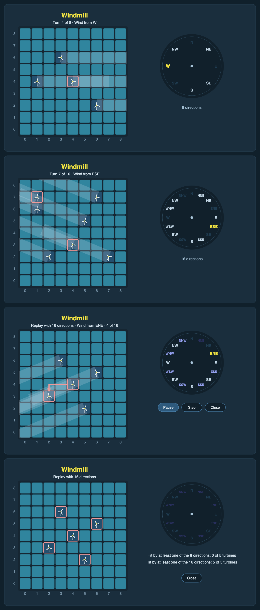

# Windmill: decisions after Step 0

Matteo's answers to every open item in [PROPOSAL.md](PROPOSAL.md), settled on
2026-11-19. Where this file and the proposal differ, this file wins.

Source: [`proposal/decided.svg`](proposal/decided.svg). It is a mock-up of the
look, not game code.

## Game rules

| # | Decision |
|---|---|
| D1 | Play ends when every direction of the setting has been used. Reset starts over. |
| D2 | **Changed from the proposal.** The wind direction is drawn automatically, at random, from the directions not used yet, as in Dandelions' default mode. No computer player, no AI. A private tap-to-pick mode (the person taps a direction on the compass) is turned on only by the URL parameter `?wind=pick`, with no mention on screen. A public toggle may come later. |
| D3 | **Changed after the phone test (2026-11-20).** A direction is named for where the wind blows toward, as in Dandelions: a N wind blows north, so the wake streaks point the way the wind is named. On screen: "Wind blows NE" and "the wind blows only in the 8 directions". *Before:* named for where the wind comes from (the weather convention), which read backwards to a Dandelions player. The README notes that weather reports name winds the other way. |
| D4 | `WAKE_HALF_WIDTH = 0.5` cells, `WAKE_LENGTH = 6` cells. |
| D5 | Every turbine casts a wake, even when it is itself hit. Hit or not: wakes do not stack. |
| D6 | One turbine and one gust per turn. Header: "Turn 3 of 8", with "Wind blows …" on a second line (see D12). The first gust cannot hit anything, but its wake is still drawn. |
| D7 | Switching between 8 and 16 directions resets the game. |

## What the screen shows

| # | Decision |
|---|---|
| D8 | Only the current gust is shown: its wakes as pale streaks and the turbines it hits with a soft-red cell border. All of it clears when the next turbine is placed. Earlier gusts leave no trace on the board. Overlapping wakes are drawn separately, so overlaps look brighter. |
| D8 compass | Current gust: gold `#f5e642`. Directions not used yet: pale `#c5d9e8`. Used directions are "switched off" in the compass's own blue `#1f3c51` (options compared in [`proposal/compass-used-options.png`](proposal/compass-used-options.png)). |
| Legend | A discreet one-line legend under the compass, small dots and muted text: "Wind now", "Still to come", "Used". In the replay, below the buttons: "Wind now", "8 directions", "Added in 16 directions", "Used" (see [`proposal/legend.png`](proposal/legend.png)). |
| Lost output | **Added after the build.** A turbine hit at least once turns vermilion (`#f0743c` blades and tower, gold hub) and stays that colour (How to Play says it "changes colour", not naming the colour, since colour-blind players see it differently): the wake passes with the gust, but the lost output stays. The red border still means "hit by this gust". A board legend under the status line reads "Hit now" and "Lost output". The replay starts every turbine fresh and changes its colour the first time a replay gust hits it, so its end screen shows vermilion turbines and no borders (no gust is blowing). A faint border on those turbines, added while the colour was a pale rose, was removed once vermilion made it redundant. *Colour changed after the phone test (2026-11-20):* the first rose `#f4bcbc` read as off-white on the phone. Vermilion was compared with salmon, deep rose, magenta and violet under simulated protanopia, deuteranopia and tritanopia: it stays clearly unlike the white turbines for all of them (olive-ochre with red-green colour blindness), and it sits in the warm sector of the palette's "X" harmony template with the gold and the red border. Magenta falls outside the template and goes dull with deuteranopia; violet turns grey with tritanopia and is close to the periwinkle of the added directions. |
| D9 | A record under the compass, one line per gust: `NE — hit: (3,4), (5,6)` or `NE — none`. |
| D10 | Axis numbers 0–8 along the bottom (x) and up the left side (y). |
| Text sizes | The turn line, axis numbers and "8 directions" caption are larger than in the first draft (see the mock-up). |

## Replay with 16 directions

| # | Decision |
|---|---|
| D11 | Available in the 8-direction setting with at least two turbines, between turns and after the game ends. Closing returns to the game unchanged. |
| D12 | The 16 gusts play clockwise from N, with **Pause / Play**, **Step** and **Close**. The header under the title always takes two lines, in the game ("Turn 5 of 8" over "Wind blows E", the second line blank before the first gust) and in the replay ("Replay with 16 directions" over "Wind blows SW · 11 of 16", blank on the end screen), so the board never moves, including when the replay opens and closes. |
| D13 | **Changed after the phone test (2026-11-20).** The public replay draws no L lines: wakes, red borders and vermilion turbines show what hit what. The L is kept for Matteo's videos as a private mode, turned on only by the URL parameter `?lines=knight` (combine with `?wind=pick` as `?wind=pick&lines=knight`), with no mention on screen. In that mode an L is drawn only for a knight's move (1 cell one way, 2 the other), the pattern the 8 directions never hit and exactly one of the 8 added directions always does. Straight and diagonal hits, and bigger offsets, get no L. Each L runs along the row first, then the column, from cell edge to cell edge with an arrowhead, under the turbines, one at a time within each gust. *Before:* one L per hit turbine from the closest upwind turbine, which drew big Ls such as 3 across and 3 up for diagonal hits. |
| D15 | End of replay: "Hit by at least one of the 8 directions: X of N turbines" and "Hit by at least one of the 16 directions: Y of N turbines". |
| Compass | The 8 added directions are periwinkle `#94a0f0` before they blow and `#282f5d` after. The original 8 follow the game's colours. Periwinkle was chosen with the hue templates of Cohen-Or et al., *Color Harmonization* (2006): the palette fits the "X" template, with the blues in one sector and gold and red in the opposite one, and periwinkle sits in the blue sector, far from cyan (see [`proposal/replay-added-options.png`](proposal/replay-added-options.png)). At the end of the replay every direction is lit again, the original 8 pale and the added 8 periwinkle, none gold, so the compass is a key for the two counts, and the legend shows only "8 directions" and "Added in 16 directions" (changed after the phone test; before, all 16 showed their dim "used" colours). |

## Text, look and packaging

| # | Decision |
|---|---|
| Rule line | "In this game, the wind blows only in the 8 directions on the compass." The number follows the setting. |
| D14 | A status line guides each step, and a short How-to-Play panel holds the rule line and the two steps of a turn. |
| D16 | Footer: "A companion to Dandelions" (linked) and "Based on Dandelions from *Math Games with Bad Drawings* by Ben Orlin". A link to the YouTube playlist "Demystifying Offshore Wind" is a hidden placeholder until the channel exists. |
| D17 | Turbine option B: off-white blades `#e8f0f5`, gold hub `#f5e642`. |
| D18 | Repo `windmill`, default branch `main`. |
| D19 | App icon: turbine B on `#1a2d3a`. |

## Learn and Play modes (2026-11-22)

Matteo's decisions after a Dandelions player cracked the 8-direction game and
found that "Replay with 16 directions" could only be watched. The reasoning and
the numbers are in [PLAY_PROPOSAL.md](PLAY_PROPOSAL.md).

| # | Decision |
|---|---|
| Spec change | **Changes the spec's "no winner, no score".** Play has a verdict and an acceptable level of loss, a target for one game, not a win. No score is kept across games. |
| D20 | Two modes, both public, switched by quiet text tabs above the title: **Play** and **Learn** (working names). Play opens first. |
| D21 | **Learn** is the game as it was: D1, D6 and D7 hold there, and "Replay with 16 directions" stays. The private URL tools (`?wind=pick`, `?lines=knight`) work in Learn only. |
| D22 | **Play: place all 8 turbines, then the winds blow** (8 or 16, the setting) over the finished layout, so the verdict judges the layout, not timing. Replaces D1 and D6 in Play. 9×9 board, 8 turbines in both settings. A placed turbine can be tapped to take it back until the wind starts. |
| D23 | **Player-paced reveal:** one wind at a time, "Next wind", with "Play all" (1.5 s per wind) and "Pause". With 8 winds they go round the compass from N. With 16, each game picks at random between round the compass and the 8 main directions first, then the 8 added ones; in that second order the added directions are periwinkle and the legend matches the replay's. The order never changes the verdict. |
| D24 | **Verdict:** "Lost output: X of 8 turbines" over "Acceptable: none" (8 winds) or "Acceptable: half or fewer" (16 winds). The status says "The best possible result." (0 lost with 8 winds, 3 with 16, the proven minimum), "Within the acceptable loss." or "More than the acceptable loss.". How to Play does not say what the best possible is, provisionally. |
| D25 | **Review at the end,** as in chess apps: tap a direction to see that wind's wakes again, tap a turbine to see which winds hit it (gold outline, the wakes that hit it, those directions gold on the compass). Legend: "Shown now", "Tap to look again". Reset becomes "New game". |
| D26 | Placing header: "None placed yet", "5 of 8 placed", "All 8 turbines placed", over "Place all 8, then the wind blows" or "Then 16 winds will blow". |
| Open | Whether a clean 8-wind game should offer the 16-wind game; whether to show testers which wind order they had. Both wait for first players' feedback. |

## Scale

The game does not show a cell size on screen, but one cell is taken to be
about **7 rotor diameters (7D)**, a typical offshore spacing. At that scale the
game's hit-or-clear rule agrees with a simple physical wake model (Jensen) for
every pair of turbines within the 6-cell wake length except one borderline
offset. At 1D it does not. The check, its assumptions and its output will be in
`tools/scale_check.py` and the README.
