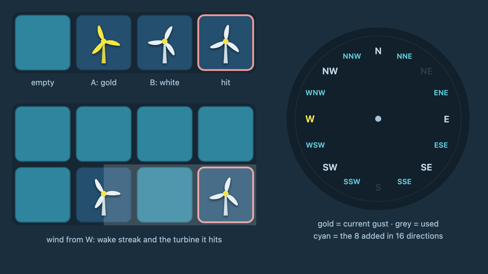

# Windmill: Step 0 proposal

A companion to [Dandelions](https://mycarta.github.io/Dandelions/). This file is
the Step 0 report: what to reuse from Dandelions, the repo structure, the
palette, the turbine symbol, a draft rule line, and every choice that needs
Matteo's confirmation. **No game code has been written yet.** The build starts
after Matteo's go.

Dandelions was read at commit `b1d2402` (local repo
`~/Documents/GitHub/Dandelions`). Nothing in it was changed.



The source is [`proposal/preview.svg`](proposal/preview.svg). It is a mock-up
of the look, not game code.

---

## 1. Findings from reading Dandelions

These change details of the plan, so they come first.

- **The flower is a text glyph, not a drawn shape.** Each flower is the
  character `✱` (U+2731) in an SVG `<text>` element. It is gold `#f5e642`,
  46px in a 100-unit cell, with a CSS drop shadow and a random per-cell
  rotation of −40° to 40°, set with an SVG `transform` attribute. A turbine
  can't be a glyph, so it will be a small SVG drawing that copies those
  traits: the same arm-like tapered blades, gold, the drop shadow and the
  random rotation (section 4).
- **The cache convention is one constant in `sw.js`.** `const CACHE =
  'dandelions-v6'` is bumped by hand whenever any cached file changes (see
  commits "Bump service worker cache to v2" and "Add Apple PWA meta tags and
  bump cache to v3"). On activation the worker deletes every other cache.
  Windmill will start at `windmill-v1` with the same rule.
- **Tests follow a "runtime-agnostic plain script" pattern.** `tools/replay-tests.js`
  uses globals from the engine files and runs either from
  `tools/replay.html` in a browser or from `node tools/replay.js` through
  `vm`. **Node is not installed on this Mac**, so Windmill's tests will use
  the same pattern, with the browser page as the main runner (headless Chrome
  can run it from the command line) and a Node runner as well.
- **The spec's test fixtures are consistent with the wake rule.** I
  recomputed all of them with an independent Python script before proposing
  anything: smallest distances 0.707 / 0.159, 1.000 / 0.224, 0.707 / 0.700,
  and pattern counts 8/9, 0/5, 0/5, 0/0. All match the prompt exactly.
- **Dandelions still uses CSS keyframe transforms on some SVG elements**
  (seed pop-in, compass pulse, win wave). That's safe there because those
  elements carry no SVG `transform` attribute. Windmill will keep both kinds
  of transform off the same element: turbines and rotors use only SVG
  `transform` attributes, never `style.transform` and never a CSS animation.

## 2. What to reuse from Dandelions

| Dandelions part | In Windmill | Copy or adapt |
|---|---|---|
| `svgEl()` helper (`game.js`) | Same | Copy |
| `buildGrid()`: 100-unit cells, rect inset 5, rx 10, click and Enter/Space handlers | 9×9 grid, viewBox `0 0 900 900`. Rows flipped, because Windmill's y grows north (row = 8 − y) | Adapt |
| `buildCompass()` with hard-coded `COMPASS_XY` for 8 points | Positions computed from the bearing, so the same code draws 8 or 16 points. Smaller font for the 3-letter labels | Adapt |
| Compass states `used` / `last-used` / `active` / `tappable` (CSS) | Same states, plus one new class for the 8 added directions in the replay | Copy CSS, add one class |
| `enableCompassTaps()` / `handleCompassClick()` from 2-player mode | The direction is always picked by tapping the compass | Adapt (no pass-the-phone overlay: nothing is hidden) |
| Per-cell random rotation via SVG `transform` attribute | Rotor rotation | Copy pattern |
| Layout CSS: page column, sidebar at ≥740px, short-screen media queries, pill toggles, reset button | Same layout, recoloured. The pill toggle becomes "8 directions / 16 directions" | Copy, recolour |
| "How to Play" collapsible panel | A short panel holding the rule line and the turn steps (see D14) | Adapt |
| `manifest.json` | Names, colours, icons | Adapt |
| `sw.js` | Cache name `windmill-v1`, Windmill's asset list, same install/activate/fetch logic | Copy, change two lines |
| iOS meta tags (`apple-mobile-web-app-capable`, status-bar style, touch icon) | Same | Copy |
| `generate-icons.html` (canvas, saves PNGs) | Draws the turbine on ocean blue | Adapt |
| Test harness pattern (`tools/replay*.js/html`) | `tests/` with a browser runner and a Node runner | Adapt |
| Wind AI, tutorial, win/lose, confetti, wave, wilt, seeds | — | **Not reused** (no winner, no AI) |

## 3. Proposed repo structure

```
~/Documents/GitHub/windmill/        (own git repo, a sibling of Dandelions)
├── index.html          page, iOS meta tags, SW registration
├── style.css           layout + ocean palette (from Dandelions' style.css)
├── wake.js             pure logic, no DOM: direction lists, constants
│                       WAKE_HALF_WIDTH / WAKE_LENGTH, downwind vector,
│                       isHit(A, B, theta), hitsForGust(turbines, theta)
├── game.js             UI: board, compass, turns, wake drawing, record, replay
├── manifest.json
├── sw.js               CACHE = 'windmill-v1' (bump on every asset change)
├── icon-192.png, icon-512.png
├── generate-icons.html
├── tests/
│   ├── wake-tests.js   distance table + four patterns + edge cases
│   ├── run.html        browser runner (main runner here: no Node)
│   └── run.js          Node runner, same file through vm, as in Dandelions
├── proposal/           preview.svg / preview.png for this report
├── PROPOSAL.md         this file
├── README.md
└── .gitignore
```

`wake.js` keeps the rule in one DOM-free file. The tests and the game load the
same code, so the tests check exactly what players see.

## 4. Turbine symbol

Three tapered blades and a round hub, which echo the arms of the `✱` flower,
on a short tower. The hub sits on the cell centre, where wakes start. Only the
rotor gets the per-turbine random rotation (−40° to 40°, as for flowers),
through an SVG `transform` attribute, so the tower always stays upright. The
drop shadow matches the flower's: `drop-shadow(0 2px 4px rgba(0,0,0,0.55))`.

```svg
<!-- (cx, cy) = cell centre; θ = random per-turbine rotation, −40..40 -->
<g class="turbine" transform="translate(cx, cy)">
  <path class="turbine-tower" d="M -1.6 4 L -3.4 36 L 3.4 36 L 1.6 4 Z"/>
  <g class="turbine-rotor" transform="rotate(θ)">
    <path class="turbine-blade"
          d="M -1.8 -4 C -5.8 -10 -5.2 -19 -1.6 -26 Q 0 -28.4 1.6 -26.6 C 3.2 -19 3.2 -10 1.8 -4 Z"/>
    <path class="turbine-blade" transform="rotate(120)" d="(same path)"/>
    <path class="turbine-blade" transform="rotate(240)" d="(same path)"/>
  </g>
  <circle class="turbine-hub" r="4.6"/>
</g>
```

**Two colour options (see the preview), Matteo to choose:**

- **A: all gold `#f5e642`.** The closest match to the flower.
- **B: off-white blades `#e8f0f5`, gold hub `#f5e642`.** Reads more like a
  real turbine and keeps the flower's gold as an accent. **Recommended.**

The rotor doesn't spin. Spinning would need an animation on an element that
already carries an SVG transform, which is the conflict to avoid.

## 5. Ocean-blue palette

Method: every green in Dandelions' `style.css`, `index.html`, `manifest.json`
and `generate-icons.html` keeps its lightness and saturation, and its hue is
moved from green (≈85–135°) to ocean blue (≈190–215°), keeping the small hue
differences between them. Non-green colours are listed at the end.

**Backgrounds and surfaces**

| Role | Dandelions | Windmill |
|---|---|---|
| Page background (`body`, pass overlay) | `#1a3d1a` | `#1a2e3d` |
| `theme-color`, manifest, icon background | `#1a3a1a` | `#1a2d3a` |
| Board background, How-to-Play panel | `#163216` | `#162632` |
| Compass disc, toggle background | `#112b11` | `#11202b` |
| Hover background (toggles, buttons) | `#1f4a1f` | `#1f384a` |
| Panel border | `#2e5f2e` | `#2e4b5f` |
| Toggle borders | `#3a6e3a` | `#3a586e` |

**Board cells**

| Role | Dandelions | Windmill |
|---|---|---|
| Empty cell fill / stroke | `#5a9e30` / `#3d7020` | `#30859e` / `#205d70` |
| Flower cell → turbine cell fill / stroke | `#246e24` / `#1a4f1a` | `#244f6e` / `#1a394f` |
| Seed cell fill / stroke (pale) | `#9fcc6a` / `#7aaa3a` | `#6abecc` / `#3a9baa`, used for the record's per-gust chips (D9) |
| Hover cell | `#7dbe40` | `#40a8be` |
| Tutorial pulse | `#a8db60` | `#60ccdb`, reused as the shade for the 8 added directions in the replay |
| Wake streak | (new) | `#c5d9e8` at 22% opacity, drawn over cells |

**Buttons**

| Role | Dandelions | Windmill |
|---|---|---|
| Active toggle / Reset button | `#2e7d32` | `#2e5a7d` |
| Reset hover | `#388e3c` | `#38688e` |
| Reset pressed | `#1b5e20` | `#1b405e` |
| Reset border | `#4caf50` | `#4c84af` |

**Text**

| Role | Dandelions | Windmill |
|---|---|---|
| Body text | `#e8f5e8` | `#e8f0f5` |
| Status line | `#d4edda` | `#d4e0ed` |
| Light text, compass labels | `#c5e8c5` | `#c5d9e8` |
| Strong text | `#d8f0d8` | `#d8e6f0` |
| Secondary text, compass centre | `#a8d8a8` | `#a8c4d8` |
| Muted text | `#7aaa7a` | `#7a96aa` |
| Attribution | `#5a8a5a` | `#5a768a` |
| Used compass direction | `#4a6a4a` | `#4a5d6a` |

**Non-green colours**

| Dandelions | Use there | In Windmill |
|---|---|---|
| `#f5e642` gold | flower, title, focus rings, active direction | Kept: title, focus, current gust on the compass, turbine hub (or the whole turbine in option A) |
| `#c8cb60` olive-gold | last-used direction | Kept, same role |
| `#ef9a9a` soft red | "Wind wins" message | Reused as the **hit** marker: a border on a hit turbine's cell |
| `#4a2c00` brown | seed dot | Dropped (no seeds) |
| Confetti colours | win confetti | Dropped (no winner) |

## 6. Rule line: DRAFT for Matteo

Shown under the compass, with the number following the setting:

> **Draft 1 (recommended):** In this game, the wind blows only from the 8 directions on the compass.

> **Draft 2:** Rule of this game: wind comes only from the directions shown on the compass.

## 7. Items to confirm with Matteo

**From the prompt (all built as stated unless Matteo says otherwise):**

- **D1.** Play ends when every direction of the setting has been used.
  Reset starts over.
- **D2.** Directions are picked by a person: the same player, or a second
  person at the same screen. There is no computer Wind player.
- **D3.** A direction is named for where the wind comes from (a N wind blows
  toward the south).
- **D4.** `WAKE_HALF_WIDTH = 0.5` cells, `WAKE_LENGTH = 6` cells, both at the
  top of `wake.js`.
- **D5.** Every turbine casts a wake, even when it is itself hit.

**New choices from this proposal (filling gaps in the prompt):**

- **D6. Turn count.** One turbine per turn and one direction per turn, so a
  game has 8 or 16 turbines. The header shows "Turn 3 of 8", where
  Dandelions shows "Round 3 of 7". The first gust can never hit anything,
  because there is only one turbine.
- **D7. Switching setting mid-game resets the game**, as switching mode does
  in Dandelions.
- **D8. Hit display.** The current gust's wakes are drawn as pale streaks,
  and the turbines they hit get a soft-red cell border. Both clear when the
  next turbine is placed.
- **D9. The record.** A compact list under the compass, one line per gust in
  play order, e.g. `NE — hit: (3,4), (5,6)` or `NE — none`. Turbines are
  identified by board coordinates.
- **D10. Coordinates on the board.** Small axis numbers, x 0–8 along the
  bottom and y 0–8 up the left side, so the record and the L lines can be
  read. Origin (0,0) at the south-west, as specified.
- **D11. When Replay is available.** In the 8-direction setting with at least
  two turbines: during play (between turns) and after the game ends. Closing
  the replay returns to the game unchanged.
- **D12. Replay pacing.** The 16 gusts play clockwise from N, about 1.2 s
  each, with a Close button. No pause or step controls (they could be added
  if wanted).
- **D13. The L.** It is drawn from the upwind turbine, along its row (east–west)
  first, then along the column (north–south) to the hit turbine. When a pair
  sits on a single row, column or diagonal, the L degenerates to a straight
  line or one corner. All hit pairs in a gust get an L.
- **D14. Instructions.** For anyone to play on their own: a status line
  ("Tap a square to place a turbine", then "Pick a wind direction on the
  compass") and a short How-to-Play panel with the rule line and the two turn
  steps. It uses no terms beyond the plain labels.
- **D15. End-of-replay counts, wording:** "Hit by at least one of the
  8 directions: X of N turbines" and "Hit by at least one of the 16 directions:
  Y of N turbines".
- **D16. Footer.** "A companion to Dandelions" linking to the live game,
  plus "Based on Dandelions from *Math Games with Bad Drawings* by Ben Orlin",
  mirroring Dandelions' attribution. Mention of the YouTube playlist: none
  unless Matteo wants a link.
- **D17. Turbine colour option** A or B (section 4). B is recommended.
- **D18. Repo location** `~/Documents/GitHub/windmill`, with `main` as the
  default branch name. Dandelions uses `master`, so say if `windmill` should
  match.
- **D19. Icon.** The turbine (chosen option) on `#1a2d3a`, made with
  `generate-icons.html` as in Dandelions.
